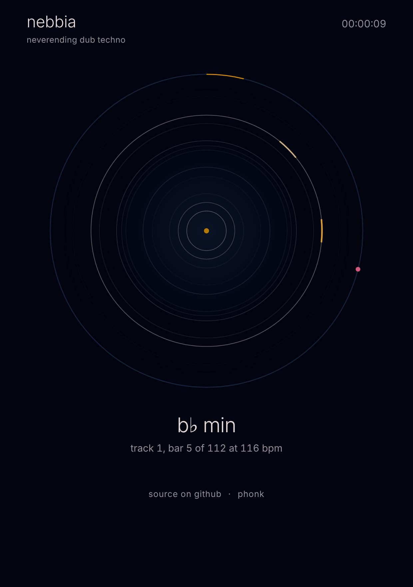

# nebbia

*neverending dub techno*

A dub techno mix that is generated live in your browser and never plays the same way twice. Nothing is recorded: every kick, chord and echo is synthesised as you listen. One HTML file, no samples, no dependencies, no install.

**▶ Play it: [phonk.github.io/nebbia](https://phonk.github.io/nebbia/)**

## Play

There is one thing to touch: **the dial**. Tap it to start, tap it again to stop. Every start is a new mix.

## What you see

- **The two inner rings** are the two decks. The marks on a ring are the chord pattern of its track, and each one lights up amber when it plays. During a transition one ring rises while the other fades.
- **The circles leaving the centre** are the repeats of the echo. They die at the rim.
- **The rim** shows the track: the amber arc is how far it has gone, the pink dot goes round once per bar.
- **The centre** pulses with the kick, and its blue glow opens and closes with the filter.

Under the dial you read the key, the track number, the bar and the tempo. The clock at the top is how long the mix has been running.

## How it works

**Tracks.** Each track is drawn at random: a key, a minor chord voicing, a two-bar stab pattern, a bass line, hats, sometimes a clap and a pad, and its own sound (filter, decay, drive, grit, echo time and feedback). A track lasts 64 to 112 bars.

**The mix.** Before a track ends, the next one comes in on the other deck, in a related key (same, a fourth or fifth away, or close by). First its chords fade in through a filter that slowly opens; halfway through, kick and bass swap from the old track to the new one; then the old track sinks into its own echo and disappears.

**Movement inside a track.** The chord filter drifts slowly on two long cycles. One hit of the stab pattern moves every 16 bars. Now and then the kick drops out for a few bars, or the hats leave. The echo feedback wanders.

**Tempo.** It drifts slowly around 114 to 120 bpm, and the echo follows it.

**Tone.** Chords are detuned saws with a layer of noise, pushed through a resonant filter and an asymmetric overdrive, then into a filtered, saturated echo and a long dark reverb. Under everything there is a bed of hiss, crackle and low rumble that pumps with the kick.

## Notes

- It can run for as long as you leave it open. The combinations never run out, though after a few hours you will recognise its habits.
- On a phone the browser may stop the sound when the screen turns off.
